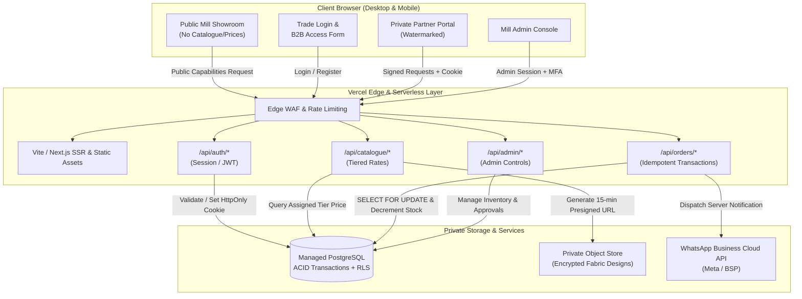
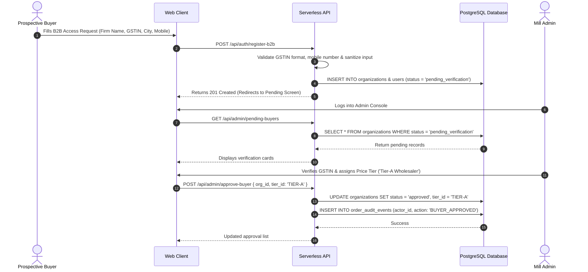
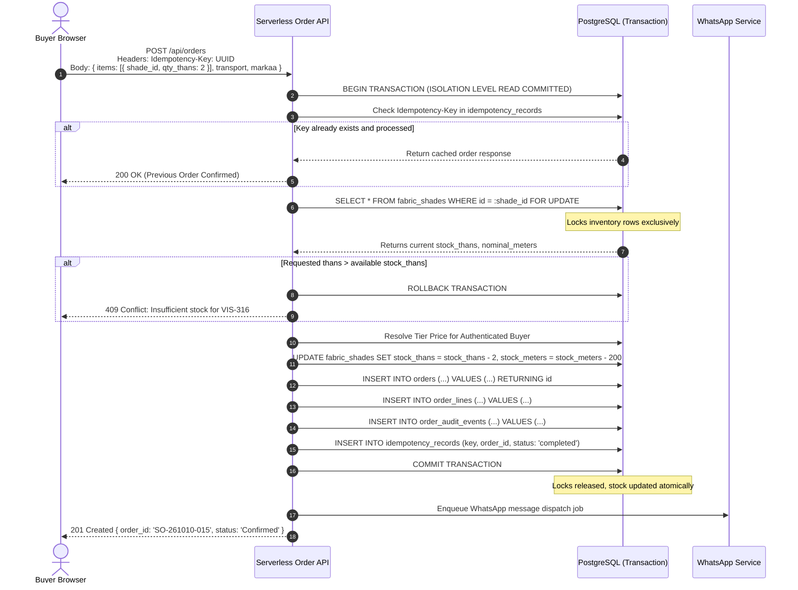
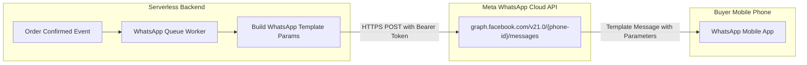
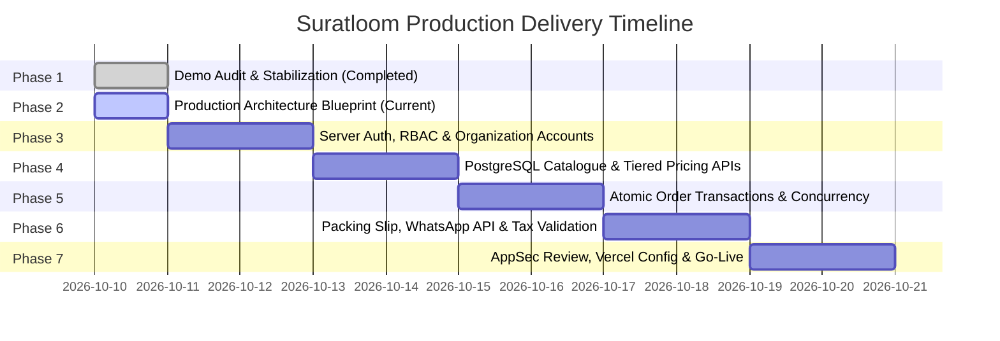

# Suratloom — Production Architecture & Security Blueprint
**System**: Private Textile B2B SaaS Platform for Surat Weaving & Dyeing Mills  
**Classification**: Confidential Technical Specification & AppSec Blueprint  
**Author**: Staff Engineer & Application Security Architect  
**Target Deployment**: Vercel (Frontend & Edge/Serverless API) + Managed PostgreSQL (Supabase / Neon / AWS RDS) + Private S3-Compatible Object Storage + WhatsApp Business Platform  

---

## 1. Executive Summary & Core Design Principles

### 1.1 The Surat Textile B2B Domain Context
Textile manufacturing in Surat operates on distinct trade dynamics unlike conventional consumer or generic B2B e-commerce:
1. **Confidentiality of Designs & Shade Cards**: Textile mills release seasonal fabrics (e.g. 58" Luxe Rayon Slub, 44" Cotton Flex, 58" Viscose Twill). Premature public exposure of unreleased prints, weaves, or shade cards allows competitors to copy constructions in competing powerlooms before orders are booked.
2. **Negotiated Wholesale Tiering**: Mills do not operate with a single public MSRP. A-category wholesalers in Delhi, regional semi-wholesalers in Bhopal, and commissioned textile brokers (dalals) in Surat trade on different price tiers, payment credit terms, and volume commitments.
3. **Textile-Specific Packaging Units**: Wholesale fabric is not sold in single meters. It moves in **Thans / Takas** (folded bolts of 80–120 meters, standard nominal ~100m), **Lumps** (continuous undoubled rolls), and **Cuts** (predetermined piece lengths). Billing is calculated in **₹/meter**, but warehouse fulfillment and stock decrement occur in **Thans** and actual lot meterage.
4. **Transport & Markaa Logistics**: Parcels are dispatched through regional textile transport agencies (e.g. Shree Maruti, VRL Logistics, Patel Transport, Navkar). Each bale or parcel is stenciled with the buyer's **Markaa** (e.g., `MF / DELHI`), which acts as the physical routing identifier in transport godowns.
5. **Kacha Bill / Packing Slip vs. Tax Invoice**: In Indian textile manufacturing, an initial dispatch voucher or *kacha bill* acts as a packing slip and loading challan verifying taka counts and nominal meters. A legally binding GST Tax Invoice (under Section 31 of the CGST Act) is generated separately following weight verification and accountant clearance.

### 1.2 Core Architectural Principles
* **Zero-Trust Client Runtime**: The browser client is strictly an untrusted presentation layer. No wholesale price calculation, stock decrement, authorization check, or order generation is trusted from the client.
* **Strict Public vs. Private Perimeter**: The public domain serves strictly as a mill profile showcasing production infrastructure, yarn-spinning capabilities, and an onboarding request form. No fabric codes, shade cards, stock levels, or prices exist in the public bundle or unauthenticated endpoints.
* **ACID Transactional Guarantees**: Inventory decrements and order creation occur within a single atomic database transaction utilizing row-level locks to eliminate overselling and race conditions.
* **Least-Privilege Secret Management**: Service-role database credentials, WhatsApp Business access tokens, and private storage keys never enter `VITE_*` browser-visible environment variables.

---

## 2. Threat Model & Security Posture (STRIDE)

| Threat Category | Threat Scenario | Impact | Architectural Mitigation |
| :--- | :--- | :--- | :--- |
| **Spoofing** | Attacker impersonates an approved A-category buyer to view negotiated rates. | High | Server-side authentication via secure, HTTP-only, SameSite cookies with cryptographically signed session tokens; mandatory email verification and admin approval before account activation. |
| **Tampering** | Buyer tampers with client HTTP payload to submit ₹45/meter instead of ₹62/meter, or tampers with order total. | Critical | Server ignores all prices and totals supplied by the client. The backend resolves variant IDs against the authenticated buyer's assigned price tier in PostgreSQL and computes totals authoritatively. |
| **Repudiation** | Buyer or broker claims they never placed an order or disputes dispatch instructions. | Medium | Append-only `order_audit_events` and `orders` ledger capturing user ID, organization ID, client IP, timestamp, idempotency key, transport choice, and markaa reference. |
| **Information Disclosure** | Competitor extracts seasonal shade cards and unreleased designs by scraping public bundle or unauthenticated APIs. | Critical | Hard separation of public and private APIs. Private catalogue endpoints require valid JWT/session check. Design assets served via private S3 buckets using short-lived (15-minute) pre-signed URLs. Dynamic user-specific watermarks embedded server-side. |
| **Denial of Service** | Malicious bot spams access request form or hammers order submission endpoint to lock inventory. | High | Edge rate-limiting (Upstash Redis / Cloudflare / Vercel Firewall), Cloudflare Turnstile CAPTCHA on onboarding forms, and short reservation timeouts (15 minutes) on unconfirmed carts. |
| **Elevation of Privilege** | Approved buyer accesses mill admin inventory controls, changes stock, or approves other buyers. | Critical | Strict Server-Side Role-Based Access Control (RBAC) enforced at middleware and database Row-Level Security (RLS) layers. Admin endpoints verify `role = 'mill_admin'` in database before execution. |

---

## 3. High-Level Data Flow & System Architecture



---

## 4. Multi-Tenant Identity, Roles & Onboarding Workflow

### 4.1 Role Hierarchy & Permissions
1. **Mill Super Admin (`mill_admin`)**: Full access to raw cost prices, inventory adjustments, order status updates, buyer approvals, price tier assignments, and transporter management.
2. **Sales Manager (`mill_sales`)**: Can view orders, update packing statuses, review pending buyers, and adjust dispatch notes. Cannot alter base fabric definitions or system settings.
3. **Approved Wholesale Buyer (`verified_buyer`)**: Can browse approved fabric catalogues, view their specific tier pricing (`priceA`, `priceB`, etc.), place orders, review order history, and download packing slips.
4. **Textile Broker (`broker`)**: Can browse catalogues with broker-specific margins, place orders on behalf of accredited buyers, track commission statements, and view dispatched lot details for assigned buyers.
5. **Pending Applicant (`pending_approval`)**: Authenticated account awaiting mill verification. Redirected to an onboarding status page; zero access to catalogue, shades, inventory, or pricing.

### 4.2 Onboarding & Verification Flow


---

## 5. Domain Modeling: Textile Quantities, Units & Conversions

### 5.1 Unit Definitions & Precision
* **Than / Taka**: The primary trade packaging unit in Surat. Fabric rolls are folded into thans. Each than has an expected nominal length (e.g. 100 meters) and an actual packed length recorded on the lot piece-list (e.g. 98.4m, 101.2m).
* **Meter**: The standard monetary settlement unit ($\text{₹}/\text{meter}$).
* **Conversion Rules**:
  $$\text{Nominal Total Meters} = \text{Ordered Thans} \times \text{Nominal Than Meters}$$
  $$\text{Line Subtotal (₹)} = \text{Nominal Total Meters} \times \text{Resolved Tier Price per Meter}$$
* **Width / Panna**: 44" (regular salwar/kurti panna), 58" (large garment/export panna), 68" (dupatta/drape panna). Width impacts fabric weight, consumption, and meterage value.
* **Piece-List Reconciliation**: When warehouse staff pack physical thans, actual piece-list meters are recorded. The final packing slip reflects exact physical meters, with line totals reconciled.

---

## 6. Tiered Pricing & Broker Margin Architecture

### 6.1 Server-Side Price Resolution Logic
Under no circumstances does the server accept unit prices or totals submitted from the client.
```sql
-- Conceptual Query executed within the Order Transaction
SELECT 
    f.id AS fabric_id,
    fs.id AS shade_id,
    f.code,
    f.nominal_than_meters,
    COALESCE(bp.custom_rate_per_meter, tp.rate_per_meter) AS effective_rate_per_meter
FROM fabric_shades fs
JOIN fabrics f ON fs.fabric_id = f.id
JOIN organizations org ON org.id = :authenticated_buyer_org_id
LEFT JOIN tier_pricing tp ON tp.fabric_id = f.id AND tp.tier_id = org.price_tier_id
LEFT JOIN buyer_contract_pricing bp ON bp.fabric_id = f.id AND bp.organization_id = org.id
WHERE fs.id = :requested_variant_id
  AND f.is_active = TRUE
  AND fs.is_active = TRUE;
```

### 6.2 Broker Commission Structure
* For orders initiated by an authorized broker:
  * Mill Base Price: e.g. ₹62/meter.
  * Broker Selling Rate: e.g. ₹66/meter (Difference of ₹4/meter credited to Broker Commission Ledger upon payment clearance).
  * System captures `broker_id`, `buyer_org_id`, `broker_commission_per_meter`, and total brokerage payable.

---

## 7. Private Asset Delivery & Watermarking Architecture

### 7.1 Confidential Design Protection
1. **Storage Isolation**: High-resolution fabric texture maps, print CAD drawings, and shade cards are stored in private S3 buckets (`suratloom-private-designs`). Public read access is blocked at the bucket policy level.
2. **Ephemeral Presigned URLs**: When an authenticated user requests a catalogue page, the server generates pre-signed URLs with a 15-minute expiration window (`ExpiresIn: 900`).
3. **Dynamic User-Specific Watermark**:
   * For CAD/print image downloads, a server-side image processing worker (Sharp / Canvas) overlays a semi-transparent, diagonal tiled watermark:
     ```
     MEHTA FABRICS · DELHI · ID: USR-8492
     CONFIDENTIAL · SURATLOOM · 10-OCT-2026
     ```
   * **Realistic Security Boundary**: As explicitly stated in project requirements, watermarking serves as a psychological and forensic deterrent against casual leakage. It does not mathematically prevent high-resolution manual screen capture.

---

## 8. Atomic Inventory Reservation & Order Concurrency

### 8.1 The Overselling Problem in Textile B2B
Multiple buyers frequently view the same limited lot of a high-demand shade (e.g. 5 thans remaining of `VIS-316 Midnight Blue`). Without concurrency controls, simultaneous checkout requests lead to overselling and dispatch failures.

### 8.2 Order Processing Sequence (With Row Locking & Idempotency)


---

## 9. Comprehensive PostgreSQL Database Schema (DDL)

```sql
-- Enable UUID extension
CREATE EXTENSION IF NOT EXISTS "uuid-ossp";

-- 1. Organizations (Mill, Wholesalers, Brokers)
CREATE TABLE organizations (
    id UUID PRIMARY KEY DEFAULT uuid_generate_v4(),
    legal_name VARCHAR(255) NOT NULL,
    trade_name VARCHAR(255),
    gstin VARCHAR(15) UNIQUE,
    org_type VARCHAR(50) NOT NULL CHECK (org_type IN ('mill', 'buyer', 'broker')),
    status VARCHAR(50) NOT NULL DEFAULT 'pending_verification' 
        CHECK (status IN ('pending_verification', 'active', 'suspended', 'rejected')),
    price_tier_id VARCHAR(50) DEFAULT 'TIER-A',
    city VARCHAR(100) NOT NULL,
    state VARCHAR(100) NOT NULL,
    address_line TEXT,
    created_at TIMESTAMPTZ NOT NULL DEFAULT NOW(),
    updated_at TIMESTAMPTZ NOT NULL DEFAULT NOW()
);

-- 2. Price Tiers Definition
CREATE TABLE price_tiers (
    id VARCHAR(50) PRIMARY KEY,
    name VARCHAR(100) NOT NULL,
    description TEXT,
    discount_markup_pct NUMERIC(5,2) NOT NULL DEFAULT 0.00,
    created_at TIMESTAMPTZ NOT NULL DEFAULT NOW()
);

-- 3. Users and Authentication
CREATE TABLE users (
    id UUID PRIMARY KEY DEFAULT uuid_generate_v4(),
    organization_id UUID NOT NULL REFERENCES organizations(id) ON DELETE RESTRICT,
    email VARCHAR(255) UNIQUE NOT NULL,
    phone VARCHAR(20) NOT NULL,
    password_hash VARCHAR(255) NOT NULL,
    full_name VARCHAR(255) NOT NULL,
    role VARCHAR(50) NOT NULL CHECK (role IN ('mill_admin', 'mill_sales', 'verified_buyer', 'broker')),
    is_active BOOLEAN NOT NULL DEFAULT TRUE,
    created_at TIMESTAMPTZ NOT NULL DEFAULT NOW(),
    updated_at TIMESTAMPTZ NOT NULL DEFAULT NOW()
);

-- 4. Fabrics (Parent Master)
CREATE TABLE fabrics (
    id UUID PRIMARY KEY DEFAULT uuid_generate_v4(),
    code VARCHAR(50) UNIQUE NOT NULL,
    name VARCHAR(255) NOT NULL,
    fabric_type VARCHAR(100) NOT NULL CHECK (fabric_type IN ('Rayon', 'Cotton', 'Viscose', 'Modal', 'Blend')),
    weave VARCHAR(100) NOT NULL,
    width VARCHAR(20) NOT NULL,
    nominal_than_meters INTEGER NOT NULL DEFAULT 100 CHECK (nominal_than_meters > 0),
    hsn_code VARCHAR(10) NOT NULL DEFAULT '5407',
    is_active BOOLEAN NOT NULL DEFAULT TRUE,
    created_at TIMESTAMPTZ NOT NULL DEFAULT NOW()
);

-- 5. Fabric Shades & Live Inventory (Stock Unit: Than)
CREATE TABLE fabric_shades (
    id UUID PRIMARY KEY DEFAULT uuid_generate_v4(),
    fabric_id UUID NOT NULL REFERENCES fabrics(id) ON DELETE RESTRICT,
    shade_code VARCHAR(50) NOT NULL,
    color_name VARCHAR(100) NOT NULL,
    swatch_key VARCHAR(100),
    preview_image_path TEXT,
    stock_thans INTEGER NOT NULL DEFAULT 0 CHECK (stock_thans >= 0),
    stock_meters NUMERIC(12,2) NOT NULL DEFAULT 0.00 CHECK (stock_meters >= 0.00),
    is_active BOOLEAN NOT NULL DEFAULT TRUE,
    created_at TIMESTAMPTZ NOT NULL DEFAULT NOW(),
    updated_at TIMESTAMPTZ NOT NULL DEFAULT NOW(),
    CONSTRAINT uq_fabric_shade UNIQUE (fabric_id, shade_code)
);

-- 6. Tier Pricing Matrix
CREATE TABLE tier_pricing (
    id UUID PRIMARY KEY DEFAULT uuid_generate_v4(),
    fabric_id UUID NOT NULL REFERENCES fabrics(id) ON DELETE CASCADE,
    tier_id VARCHAR(50) NOT NULL REFERENCES price_tiers(id) ON DELETE CASCADE,
    rate_per_meter NUMERIC(10,2) NOT NULL CHECK (rate_per_meter > 0),
    created_at TIMESTAMPTZ NOT NULL DEFAULT NOW(),
    CONSTRAINT uq_fabric_tier UNIQUE (fabric_id, tier_id)
);

-- 7. Transporters & Logistics Directory
CREATE TABLE transporters (
    id UUID PRIMARY KEY DEFAULT uuid_generate_v4(),
    name VARCHAR(255) NOT NULL,
    contact_phone VARCHAR(20),
    surat_godown_address TEXT,
    is_active BOOLEAN NOT NULL DEFAULT TRUE
);

-- 8. Orders Ledger
CREATE TABLE orders (
    id VARCHAR(50) PRIMARY KEY, -- Formatted: SO-YYMMDD-XXX
    buyer_org_id UUID NOT NULL REFERENCES organizations(id) ON DELETE RESTRICT,
    placed_by_user_id UUID NOT NULL REFERENCES users(id) ON DELETE RESTRICT,
    broker_id UUID REFERENCES users(id) ON DELETE RESTRICT,
    status VARCHAR(50) NOT NULL DEFAULT 'Confirmed' 
        CHECK (status IN ('Confirmed', 'Packed', 'Dispatched', 'Delivered', 'Cancelled')),
    total_thans INTEGER NOT NULL CHECK (total_thans > 0),
    total_meters NUMERIC(12,2) NOT NULL CHECK (total_meters > 0),
    subtotal_amount NUMERIC(14,2) NOT NULL CHECK (subtotal_amount >= 0),
    tax_amount NUMERIC(14,2) DEFAULT 0.00,
    grand_total NUMERIC(14,2) NOT NULL CHECK (grand_total >= 0),
    transport_name VARCHAR(255) NOT NULL,
    markaa VARCHAR(100) NOT NULL,
    dispatch_lr_number VARCHAR(100),
    order_date DATE NOT NULL DEFAULT CURRENT_DATE,
    created_at TIMESTAMPTZ NOT NULL DEFAULT NOW(),
    updated_at TIMESTAMPTZ NOT NULL DEFAULT NOW()
);

-- 9. Order Line Items
CREATE TABLE order_lines (
    id UUID PRIMARY KEY DEFAULT uuid_generate_v4(),
    order_id VARCHAR(50) NOT NULL REFERENCES orders(id) ON DELETE CASCADE,
    fabric_shade_id UUID NOT NULL REFERENCES fabric_shades(id) ON DELETE RESTRICT,
    quantity_thans INTEGER NOT NULL CHECK (quantity_thans > 0),
    meters NUMERIC(12,2) NOT NULL CHECK (meters > 0),
    rate_per_meter NUMERIC(10,2) NOT NULL CHECK (rate_per_meter > 0),
    line_total NUMERIC(14,2) NOT NULL CHECK (line_total >= 0),
    hsn_code VARCHAR(10) NOT NULL
);

-- 10. Audit Ledger (Immutable Record of State & Stock Transitions)
CREATE TABLE order_audit_events (
    id UUID PRIMARY KEY DEFAULT uuid_generate_v4(),
    order_id VARCHAR(50) REFERENCES orders(id) ON DELETE SET NULL,
    actor_id UUID NOT NULL REFERENCES users(id) ON DELETE RESTRICT,
    action VARCHAR(100) NOT NULL,
    old_state JSONB,
    new_state JSONB,
    ip_address VARCHAR(45),
    user_agent TEXT,
    created_at TIMESTAMPTZ NOT NULL DEFAULT NOW()
);

-- 11. Idempotency Records
CREATE TABLE idempotency_records (
    idempotency_key UUID PRIMARY KEY,
    user_id UUID NOT NULL REFERENCES users(id) ON DELETE CASCADE,
    order_id VARCHAR(50) REFERENCES orders(id) ON DELETE CASCADE,
    request_hash VARCHAR(64) NOT NULL,
    response_body JSONB,
    created_at TIMESTAMPTZ NOT NULL DEFAULT NOW()
);

-- Indexes for high-frequency queries
CREATE INDEX idx_fabric_shades_stock ON fabric_shades(fabric_id, stock_thans);
CREATE INDEX idx_orders_buyer ON orders(buyer_org_id, status);
CREATE INDEX idx_order_lines_order ON order_lines(order_id);
CREATE INDEX idx_audit_order ON order_audit_events(order_id);
```

---

## 10. Logistics, Kacha Bill Preview & WhatsApp Integration

### 10.1 Packing Slip / Kacha Bill Specifications
The generated packing slip contains:
* Mill Header: Mill Name, Surat Weaving & Dyeing Mills, GSTIN (optional/unconfigured until cleared), Factory Address.
* Consignee: Buyer Business Name, City, Destination Station.
* Logistics Block: Transport Agency, Destination Godown, **Markaa Stencil Code** (e.g. `MF / DELHI`).
* Lot Itemization: Fabric Code, Construction, Shade Code, Thans Count, Total Nominal/Actual Meters, HSN Code.
* **Mandatory Legal Disclaimer**:
  > *"PACKING SLIP & DISPATCH MEMO ONLY — NOT A VALID TAX INVOICE UNDER SECTION 31 OF THE CGST ACT. APPLICABLE GST AND HSN TAX RATES MUST BE CERTIFIED BY THE COMPANY ACCOUNTANT PRIOR TO COMMERCIAL SETTLEMENT."*

### 10.2 WhatsApp Business API Architecture


* **Template Security Rules**:
  1. No unapproved raw text messages. Meta requires pre-approved template categories (`ORDER_UPDATE` / `UTILITY`).
  2. Variables passed: `{{1}}` (Buyer Name), `{{2}}` (Order ID), `{{3}}` (Total Thans & Meters), `{{4}}` (Transport), `{{5}}` (Markaa).
  3. Credentials (`WHATSAPP_PHONE_NUMBER_ID`, `WHATSAPP_ACCESS_TOKEN`) reside strictly in encrypted environment variables.

---

## 11. Vercel & Production Deployment Strategy

### 11.1 Component Mapping & Hosting Topology
* **Frontend**: Next.js / Vite SPA hosted on **Vercel** with global Edge CDN caching for public showroom assets.
* **Backend API**: Vercel Serverless Functions (`/api/*`) executing Node.js 20+ runtime.
* **Database**: Managed PostgreSQL on Supabase or Neon (AWS ap-south-1 / Mumbai region for minimum latency to Surat users).
* **Object Storage**: Private bucket on Cloudflare R2 or AWS S3 (Mumbai).

### 11.2 Required Environment Variables

```bash
# Application Runtime
NODE_ENV=production
APP_URL=https://app.suratloom.com

# PostgreSQL Connection (Server-Side Only - NEVER expose to browser)
DATABASE_URL=postgresql://postgres:[PASSWORD]@[HOST]:5432/suratloom?sslmode=require
DATABASE_POOL_MAX=20

# Authentication & Session Security (Server-Side Only)
AUTH_SECRET=super_secret_64_char_random_hex_string
SESSION_COOKIE_NAME=__Host-suratloom-session
SESSION_MAX_AGE_SECONDS=604800 # 7 days

# Private Object Storage (Server-Side Only)
S3_REGION=ap-south-1
S3_BUCKET_NAME=suratloom-private-designs
S3_ACCESS_KEY_ID=AKIA...
S3_SECRET_ACCESS_KEY=...

# WhatsApp Business Cloud API (Server-Side Only)
WHATSAPP_API_URL=https://graph.facebook.com/v21.0
WHATSAPP_PHONE_NUMBER_ID=...
WHATSAPP_ACCESS_TOKEN=...
WHATSAPP_TEMPLATE_NAME=order_confirmation_v1

# GST / Tax Compliance (Requires Mill Accountant Clearance)
GST_SYSTEM_ENABLED=false # Must remain false until cleared by mill owner
DEFAULT_TEXTILE_HSN=5407
```

---

## 12. Phased Migration Plan (From Starter Demo to Production)



---

## 13. Exact Acceptance Criteria for Production Implementation

1. **Public Perimeter Isolation**: Unauthenticated requests to `/api/catalogue/*` or `/api/fabrics/*` return HTTP 401 Unauthorized; no catalogue data appears in client bundles.
2. **Server-Side Price Validation**: Order submission with tampered line totals or per-meter prices is rejected; prices are calculated strictly from DB tier records.
3. **Atomic Stock Decrement**: Simultaneous order submissions for the last remaining stock of a shade are handled via `SELECT ... FOR UPDATE`, guaranteeing zero negative stock or overselling.
4. **Idempotency Guarantee**: Resending identical `Idempotency-Key` returns the original confirmed order without duplicate inventory decrement or double order logging.
5. **Private Asset Integrity**: Fabric CAD/shade images are inaccessible publicly; presigned URLs expire after 15 minutes.
6. **WhatsApp Delivery**: Real messages are triggered only via verified server-side background worker using Meta API; missing credentials gracefully route to mock adapter without crashing.

---

## 14. Decisions Requiring Mill Owner & Stakeholder Sign-Off

1. **GST & HSN Tax Accounting Model**:
   - Decision required: Does the mill wish to display indicative GST (e.g. 5% or 12%) on the portal order draft, or maintain the pure *kacha bill / packing slip* approach where tax invoices are raised strictly offline in Tally/Busy ERP?
2. **Identity & Auth Provider Selection**:
   - Decision required: Shall we use managed Supabase Auth, Auth0, or self-hosted PostgreSQL JWT/session authentication?
3. **WhatsApp Business Solution Provider (BSP)**:
   - Decision required: Direct Meta Cloud API account or third-party Indian BSP (e.g. Gupshup, Wati, AiSensy)?
4. **Than Meterage Tolerance Policy**:
   - Decision required: Does the mill accept nominal 100m billing with post-packing adjustments, or must every physical than be scanned from a barcode/taka piece-list before order confirmation?
